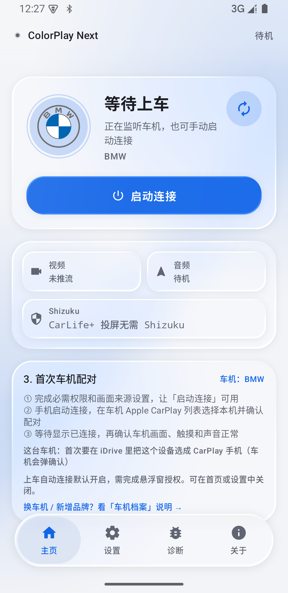
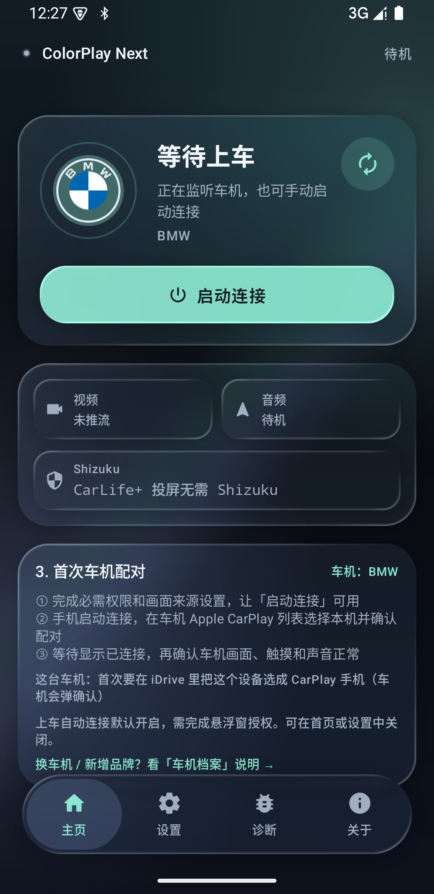
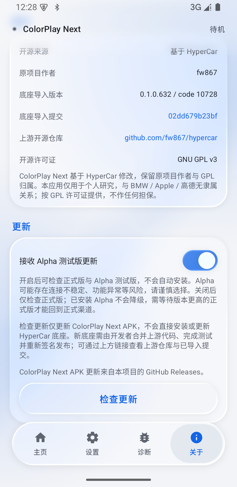
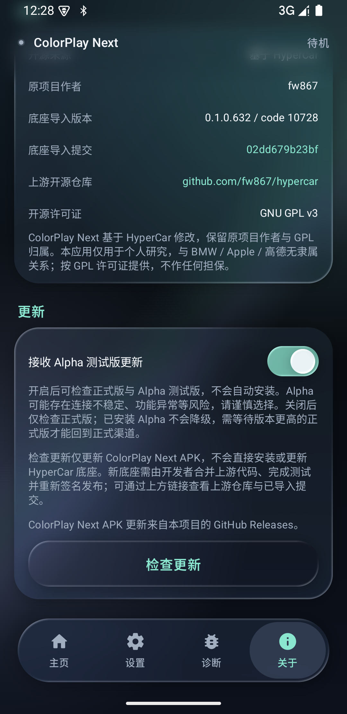
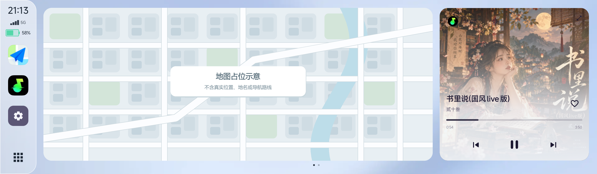
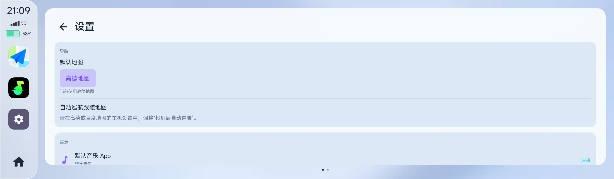
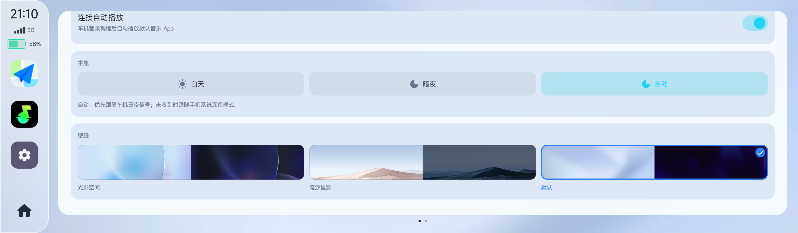
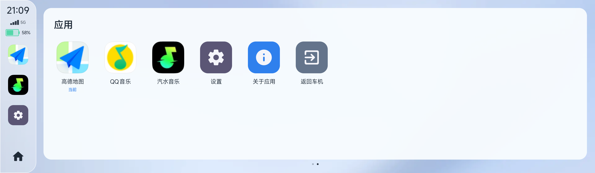

# ColorPlay Next

Android 原生 Compose 应用，基于 [HyperCar](https://github.com/fw867/hypercar)（导入提交 `02dd679b23bf8635aa07a4dbd1e80d530f19f1af`），面向一加 16 / ColorOS 17 的 OPPO Car+ 无线 CarPlay 桥接。

## 本分支状态

- 应用包名 `com.emxxme.colorplaynext`；沿用旧版签名材料与图标，正式版本 `0.2.12/212`（已发布 Release）。签名私钥及配置不入库。
- Android 原生 Compose，不引入跨平台构建；集成 AndroidLiquidGlass 的 Backdrop 1.0.0 背景采样、模糊及镜头折射，底栏为页面上的独立浮层，顶部为背景模糊并沿下缘渐隐的玻璃浮层。页面背景、内容分别录制，避免采样自身。不使用库全强度默认高光或额外整圈描边，以折射为主体，配合明确调低的方向反光、柔和阴影和分级表面染色区分卡片/底栏/背景；底栏为独立 LiquidBottomTabs，带弹簧移动的折射指示器，支持点选与横向拖动。
- OPPO 源仅在启动阶段持续拒连、Shizuku 可用、当前会话仍有效时有界拉起 `com.oplus.ocar/.CarlifeActivity`；已经连接的源不重开。保留其他系统 CarLife+ 的手动入口。
- 导航、音乐、触摸、方向盘按键及自动重连沿用上游实现；一加16、原厂无线接收端与盒子的实际闭环仍需逐项真机验证，不宣称全部已兼容。
- OPPO 组件与时序经验参考本地 ColorPlay 实测；协议研究参考 [CarDeck](https://github.com/shaonialife/cardeck)。未合入 ColorPlay 反编译主体或厂商密钥。
- 本衍生版本遵循 GPL-3.0，保留上游历史和许可。以下保留上游使用说明，涉及 HyperCar 品牌、平台验证与发布地址的内容属于上游说明，不代表本分支验收。

## 界面预览

以下为 `0.2.12/212` 在 Android 模拟器中的实际截图，未连接车机，仅展示界面与更新渠道设置，不代表实车连接验收；该版本已发布正式 Release。

| 浅色首页 | 深色首页 |
|---|---|
|  |  |

| 浅色更新设置 | 深色更新设置 |
|---|---|
|  |  |

## 公共界面组件

页面主要控件已抽取到 `app/src/main/java/io/github/hypercar/ui/components/`：

| 控件 | 公共组件 | 统一维护范围 |
|---|---|---|
| 开关 | `GlassSwitch` | 轨道/滑块对比、折射、禁用态与 Switch 无障碍语义 |
| 按钮 | `CapsuleButton`、`GlassBackButton` | 主次按钮、文字对比、返回触控区域与圆角点击反馈 |
| 卡片 | `GlassPanel` / `Modifier.glassPanel` | 分主题染色、背景采样、模糊/折射及轻阴影 |
| 悬浮底栏 | `LiquidBottomTabs` | 页面采样、透明背景、选中指示器及拖动交互 |
| 底部面板 | `GlassBottomSheet` | 跨窗口背景采样与玻璃表面 |

底层 `liquidGlassSurface` 负责共有材质绘制；业务页面应优先复用组件，不重复实现。系统确认对话框、文本操作按钮与车联内容布局仍按各自语义处理，并非把所有 Android 控件强制替换为同一种玻璃外观。

## 更新渠道选择

“关于 → 更新”中的 **接收 Alpha 测试版更新** 开关会持久保存。稳定版首次默认关闭；Alpha 安装首次默认开启，用户明确关闭后不会被覆盖。开启时比较可下载的正式版与 Alpha，关闭时只检查正式版；切换会立即重新检查并丢弃旧渠道的未完成结果，不会自动安装。

Alpha 用于提前体验自动合入的 HyperCar 新底座，可能存在连接与功能异常。它与正式版沿用相同包名/证书，安装后会覆盖当前应用，不会形成第二个 App。关闭开关不会降级，回到正式版必须等待更高版本及安装编号。启用测试版时当前读取最近 100 个 GitHub Releases。

## 底座维护

- 已导入 HyperCar `0.1.0.632 / 10728`，提交 `02dd679b23bf8635aa07a4dbd1e80d530f19f1af`；`app/src/main/java/io/github/hypercar/UpstreamBase.kt` 是关于页底座信息的单点来源。
- 本地 `upstream` 远端指向 `https://github.com/fw867/hypercar.git`；新克隆需执行 `git remote add upstream https://github.com/fw867/hypercar.git`。保留原历史，不以覆盖文件方式更新底座。
- 审计入口：`python3 tools/check-hypercar-base.py --fetch` 校验已导入版本、读取上游更新及本分支差异，只 fetch/比较，不自动合并、改底座记录或发布。离线核查可用 `--target <已知提交>`。
- 升级顺序：干净工作区 → `git fetch upstream main` → 对比 `UpstreamBase.COMMIT..upstream/main` → 在独立升级分支合并 → 审查 OPPO / UI 接入冲突 → JVM、原生、Release Lint 和真机回归 → 更新底座记录并用原证书发布。fetch 失败时不更新底座记录。
- 尽可能将定制封装在独立文件；必须修改的会话接入点保持小范围，不能保证完全无冲突。应用内“检查更新”只检查 ColorPlay Next APK，不直接替换底座、不安装 HyperCar APK。

## Car+ 车联（0.2.16）

- 在“设置 → 画面来源”选择 **Car+ 车联**；只检测 OPPO / 一加 / ColorOS 的 `com.oplus.ocar`、`com.oplus.carplus`、`com.coloros.carplus`，缺少系统应用时不允许连接。无需把 Shizuku 设为硬性前置条件。
- 本地 CarLife 接收/拨号服务可预热，但不会因此打开 Car+。只有当前 CarPlay 引擎完成控制协商、回报 `connected / CONTROL_READY` 后，才尝试打开手机 Car+ 的画面入口；不以蓝牙连接、监听 7240、开始拨号或等待视频首帧作为触发条件。
- 启动按连接 attempt 与引擎 owner 隔离；停止、断开及旧回调会取消尚未提交的动作。同轮连接只执行一次自动启动流程，已有当前引擎视频帧时不重复打开源端（以即时首帧流水线信号和周期统计共同判定，不以本地 CMD 连接为准）。只使用可导出的普通入口，不自动用特权 shell 绕过非导出入口。启动请求被 Android 后台限制时可能需要用户手动进入手机 Car+ 的 CarLife 无线连接页，不把提交 Intent 当成已出画面。
- 对齐旧 ColorPlay 的显式启动方式：优先 `com.oplus.ocar/.CarlifeActivity` 并指定手机主显示屏（display 0），不再把普通 Launcher／智慧车载设置页当作投屏入口；帮助、引导、下载等页面不参与选择。控制连接就绪后可用“前台启动 Car+ 画面”按钮，从可见 Activity 发起一次明确重试，仍受当前会话和引擎门禁保护。入口诊断独立于详细日志开关保留在当前进程的有界缓冲中，并显示于设置页、写入导出文件；只报告请求结果，不把启动 Intent 等同于视频或声音可用。2026-11-28 用户对本批 0.2.16/217 测试包反馈：一加16 / ColorOS17 + 君用 T2，采用“通用（0.27）”档案、Car+ 来源，不打开应用上车也能自动连接并弹出画面，音频与触摸正常。此结论仅覆盖该手机和盒子组合，不推广为所有设备兼容。
- `carplus/CarPlusController.kt` 与 `CarPlusLaunchPolicy.kt` 隔离组件发现、延迟启动和代次预算；通过少量来源策略与生命周期接入点复用现有系统 CarLife / AirPlay 通道，不修改 Rust 协议、不添加 JNI、不替换参考 APK 的二进制。原自绘 UI、CarWith 和系统 CarLife+ 模式保持原启动策略。
- 已有上述一加 / 君用 T2 场景的用户实测反馈；其他手机、原厂车机、长期重连及切屏场景仍需分别验证。自动跟随上游仍遵守完整测试、验签与源码冲突中止规则；不能保证任意未来上游改动零冲突，禁止为保留定制而整文件自动选边。

## 上游正式 Release 自动跟随

- 用户授权的正式发布通道使用工作流“跟随上游官方正式 Release”，每小时检查一次 `fw867/hypercar` 的正式 Release（GitHub 定时任务可能延迟）；草稿和预发布不触发正式版。现有每日北京时间 06:00 的 Alpha 通道继续独立运行。
- 首次运行只登记已存在的上游正式 Release，不补发历史版本；后续新增的正式 Release 按发布时间顺序处理。同一 Release 的发布记录持久保存，避免重复出包。历史回补必须手动填写 `upstream_tag` 并明确勾选 `allow_backfill`。
- 从 `main` 的本项目源码出发，获取上游 Release 的精确 tag 提交，不合入 Alpha 分支，也不直接下载或转发上游 APK。仅项目身份/自动化文件按明确保护清单保留本仓库版本，业务源码冲突必须人工处理。
- 候选必须通过 Rust 全量测试与原生编译、Android 单元测试、Release Lint、Release 构建和原证书指纹强校验。全部通过后才更新 `main` 并发布正式 Release；版本号和安装编号考虑已发布正式版、Alpha 及当前分支，不允许安装编号倒退或覆盖既有标签。
- 正式/Alpha 发布共享同一并发锁。Git 推送与 Release API 不属于跨服务原子事务：若在推送后发布失败，不推进成功游标，后续优先恢复相同候选；若 `main` 已继续前进、出现不完整草稿/缺失附件、其他渠道占用更高编号，或标签/证书变化，则停止并要求人工处理，不擅自改写历史。正式包先上传至草稿，上传完成才公开为正式版；不会把空 Release 当作发布成功。
- 自动化门禁通过不等于完成实车验收。用户可在 GitHub Actions 查看具体上游版本、提交、测试和发布结果；源码冲突或任一步验证失败均不会被跳过。

## Alpha 自动升级实验线

- `main` 保持正式开发线；`alpha` 是用户授权的自动合并实验线，沿用包名与原证书，安装后会覆盖正式 App，并非独立双开应用。
- 工作流“同步上游并发布 Alpha”必须留在默认分支 `main`。每天北京时间 06:00（GitHub schedule 可能延迟）检测 `fw867/hypercar/main`，也可在 Actions 选择 **main** 手动 Run workflow。首次从新建 alpha 起点引导一个候选版，其后无上游变化不重复出包。
- 顺序：准备临时合并 → Rust 全量测试与交叉编译 → Android 单测/Lint/Release 构建 → 原签名指纹强校验 → 普通推送 alpha → 发布 `vX.Y.Z-alpha.N` 预发布，绝不设置为 latest。合并冲突不自动选边，验证失败不推进 alpha。
- 签名使用仓库 Secrets `KEYSTORE_BASE64`、`KEYSTORE_PASSWORD`、`KEY_ALIAS`、`KEY_PASSWORD`，缺失直接失败。已知的历史 Rust 测试失败仍会阻止 Alpha，不以跳过测试冒充验证通过。
- 应用内“接收 Alpha 测试版更新”开关关闭时只检查最新正式版，开启时比较本仓库合法 Alpha 与正式版。Alpha 构建通过不代表已完成真机/实车验收；正式版仅由人工授权发布，或由上述已授权的上游正式 Release 跟随通道完成全套门禁后发布。
- 安装编号按 `max(alpha, main) + 1` 递增；升级回正式版必须发布更大的 versionCode，并使用不低于 Alpha 目标核心版本的正式版本号，不能直接覆盖回旧正式 APK。`main` 定制变更需要人工同步至 alpha；本流程仅自动同步上游。
- `.github`、`tools`、版本文件、底座元数据与项目约定由本分支维护，上游不能静默替换发布脚本。Release 上传若在分支推送后失败，重跑会尝试重发同一候选版，不移动已有发布标签。

## 上游 HyperCar 说明

让 Android 手机连接无线 CarPlay 车机，将地图、音乐和应用画面送到车机屏幕，并转发声音与触摸操作。支持 **自绘车机 UI**、**小米 CarWith** 和 **系统 CarLife+** 三种画面来源，无需 root。

[下载 APK](https://github.com/fw867/hypercar/releases/latest) · [使用与开发文档](docs/README.md) · [验证范围](docs/VALIDATION.md) · [反馈问题](https://github.com/fw867/hypercar/issues)

## 注意事项

1. **反馈问题请附上故障现场日志。** 在 [GitHub Issues](https://github.com/fw867/hypercar/issues) 提交反馈时，请完整描述故障现象，包括 App 版本、车机型号与档案、画面来源、复现步骤和具体报错。故障发生后，请立即从 HyperCar 的「诊断」页导出txt日志，并附在 Issue 中。无完整日志的Issues无法定位故障会直接关闭。
2. **宝马二次上车提示连接失败时，可保留配对重连。** 在车机的「移动设备」设置中点击「连接新设备」，等列表出现手机名称后，点选该手机。这一步可触发车机重新发送 CarPlay 邀请，车机和手机都无需删除原有配对记录。

## 主要功能

- **三种画面来源**：自绘 UI 提供地图、音乐卡片与 Dock；CarWith 模式转发小米 CarWith；CarLife+ 模式接入手机系统提供的 CarLife+ 无线连接界面，详见[使用说明与验证边界](docs/SYSTEM-CARLIFE-SOURCE.md)。
- **地图与导航**：自绘 UI 支持已安装的高德、百度地图；首页卡片可触摸拖动，通过 Dock 地图图标进入全屏。卡片与全屏复用地图任务，短时断开保留地图进程；高德结构化数据可用于卡片导航提示。
- **音乐控制**：显示播放器提供的专辑封面、播放状态，支持播放/暂停、切歌及播放器允许的收藏操作，也可打开播放器界面。可选择默认音乐 App 和连接自动播放。
- **声音转发**：提供「自动」「PCM」「AAC 优先」，CarWith 与自绘 UI 共用输出链路。AAC和缓冲音频需接收端声明支持。
- **自动连接与唤醒**：支持目标车机、增强发现、待机通知、首页自动连接快捷开关及有界断线恢复。
- **外观与诊断**：手机 App 支持深色、HyperOS 风格浅色和跟随系统；连接阶段、推流参数与日志导出用于排查问题。

方向盘媒体键与语音转发已实现，具体按键取决于车机报告及当前来源；车机麦克风与 HUD 属于实验功能，见下方说明。

## 车机档案

在「设置 → 我的车机」选择档案及目标设备。内置档案离线可用，也可在 App 中更新远程档案；远程更新可调整兼容策略，新增原生功能仍需更新 App。

| 设置中的档案 | 适配对象 | 连接特点 |
|---|---|---|
| **BMW** | ID7-ID8.5（MGU-86 / MGU-55） | 由车机发起无线 CarPlay，按 MGU 流程从蓝牙交接到 Wi-Fi |
| **BMW ID9** | IDC23 / ID9 | 支持 IPv6，主屏与 HID 就绪后激活会话 |
| **BMW ID6** | NBT Evo | 按车机声明协商音频，音频与主屏就绪后激活会话 |
| **大众 Volkswagen** | VW4131 / VW4211，参考 ID.7、帕萨特 2025 | 保持蓝牙与车机 Wi-Fi，等待本轮 CarPlay 邀请 |
| **Audi MIB3** | MMI 6318 / 9310 / 3315 | 支持 mDNS 发现和晚到的 `0x4301` 端点 |
| **奔驰 Mercedes-Benz** | MBUX（MB_D-PP / MB_E-P） | 保留蓝牙，画面和音频按车机声明协商 |
| **通用（0.27）** | 未单独适配的接收端 | 优先通过 mDNS 找端点，找不到时尝试 7000 端口 |
| **通用摩托车** | 突破者 M2PRO | 沿用 BMW 连接流程，保留蓝牙并跳过车机蓝牙交接命令 |
| **WinPlay** | PC 接收端 | 控制端口优先采用 mDNS 公告，校验手机真实蓝牙 MAC |

按车机硬件平台选择档案，IDC23 使用 BMW ID9，NBT Evo 使用 BMW ID6。未知车型可从「通用（0.27）」开始。

## 手机要求与画面来源

- **Android 12 及以上、arm64-v8a** 手机。
- 车机支持无线 Apple CarPlay，手机蓝牙与 Wi-Fi 保持开启。
- 按首页引导完成必需权限；后台运行、静默入网及系统音频采集能力受 ROM 和应用限制。

| 画面来源 | 必需条件 | 画面与设置 |
|---|---|---|
| **自绘车机 UI** | 安装、启动 Shizuku，并成功授权 HyperCar；安装所需地图和音乐 App | HyperCar 渲染首页；车机内可设置默认地图、音乐、自动播放、日夜主题与壁纸 |
| **CarWith** | 系统已安装并启用小米 CarWith（`com.miui.carlink`） | 使用 CarWith 自身界面，HyperCar 自动适配车机屏幕，无需手动设置分辨率。无需 Shizuku；未授权时，首次加入车机 Wi-Fi 或手动连接请求开启蓝牙可发现，可能需要按系统提示确认 |
| **CarLife+** | 手机系统提供可用的 CarLife+ 无线连接功能 | 在手机手动进入 CarLife+ 无线连接并保持等待，再由 HyperCar 连接车机；无需 Shizuku，默认使用手机麦克风。部分 ROM 尚需实机验证 |

CarWith 是否可用取决于系统是否提供该组件，不仅取决于手机品牌。部分静默入网、蓝牙回连辅助仍依赖 Shizuku 或系统授权。

## 首次使用

1. 从 [Releases](https://github.com/fw867/hypercar/releases/latest) 下载 APK 安装，打开 HyperCar，按首页引导授予附近设备、通知等必需权限。Android 12 / 12L 还需定位权限与定位服务。
2. **明确选择画面来源**。自绘 UI 必须先完成 Shizuku 授权；未安装时，App 提供下载入口。CarWith 需检测到可用系统组件。条件满足后才允许开始连接。
3. 在「我的车机」选择合适档案和目标车机，完成系统蓝牙配对，并在车机侧选择该手机、确认 Apple CarPlay 授权。部分车机首次需要手动加入车机 Wi-Fi。
4. 自绘 UI 使用前，先在手机地图、音乐 App 中完成初始化。音乐封面和控制需授予系统「通知使用权」。
5. 「上车自动连接」新安装默认开启，授予悬浮窗权限并完成启动条件后开始监听；按系统要求设置自启动和电池优化。Android 13+ 可为目标车机授权增强发现。
6. 连接后分别确认车机桌面、声音和触摸。诊断中的「控制已连接」或视频写帧增长，不等于车机已进入 CarPlay 桌面。

无互联网的车机热点按局域网方式连接时，HyperCar 绑定车机网络，其他 App 使用系统默认网络；实际入网授权与移动数据可用性仍取决于系统设置。

## 设置入口

| 分类 | 主要内容 |
|---|---|
| **我的车机** | 上车自动连接、车机档案、远程档案更新、目标设备与增强发现 |
| **画面与声音** | 画面来源、CarWith 设置快捷入口、分辨率与帧率、音频格式、画面资源联动 |
| **主题与外观** | 手机 App 深色、浅色、跟随系统；仅改变手机 App，车机界面主题在车机内设置 |
| **权限与后台** | 系统权限、通知使用权、后台运行与 Shizuku 授权 |
| **高级设置** | 手动蓝牙地址及配对身份清理 |

诊断页提供会话信息与日志导出。自绘 UI 内的地图、音乐、日夜主题和壁纸通过车机界面的设置入口调整。

### 显示与声音

- **分辨率**：自绘 UI 优先使用车机上报尺寸，未上报时使用设置中的兜底值，默认 **1920×1080**。CarWith 模式按车机屏幕分辨率自动换算源画面尺寸（上限 **2560×2560**），再按需拉伸适配车机屏幕，无需在系统 CarWith 中手动设置分辨率。
- **帧率**：可在「画面与声音」选择；实际输出取决于画面更新、编码器和接收端能力，静止地图不一定持续满帧率。
- **音频**：自绘和 CarWith 均默认转发声音。音频格式可选自动、PCM 或 AAC 优先。缓冲音频在车机声音支持且使用AAC时尝试协商开启，CarWith 默认启用车机麦克风，在请求语音输入且车机支持时收音。

### 自动连接与车机联动

- **首次连接**：BMW 等要求本轮激活的档案等待车机邀请或本轮 iAP2 端点；已配对、连上热点或端口可达，均不能代替授权。
- **主动停止**：开启自动连接时，主动停止会暂停自动连接 10 分钟，手动启动可解除暂停。
- **画面资源联动**：按车机屏幕资源变化建立或释放视频通道，保留音频和控制；部分档案会强制启用。
- **HUD / 仪表导航**：已有导航数据接入与订阅转发，需要车机实际订阅和支持；尚不能承诺 HUD 显示正常。详见[导航说明](docs/NAVIGATION.md)。

## 界面示例

以下截图来自当前自绘 UI。首页地图区域已用代码替换为不含真实位置、地名和导航路线的占位图，其余 UI 保留实际截图；占位图不代表地图的实际渲染样式。



<details>
<summary>更多界面示例</summary>







</details>

## 构建与开发

Kotlin / Compose 管理界面、蓝牙、网络与会话；Shizuku 为自绘模式提供虚拟屏、触摸注入和系统播放采集；Rust 负责 AirPlay 控制、H.264、PCM / AAC 和实验麦克风链路。

需要 JDK 17、Android SDK 35、NDK r27c、Rust 和 cargo-ndk。Windows 可使用仓库脚本构建调试包：

```powershell
pwsh -File tools\build-local.ps1

# 仅修改 Kotlin / 资源，且已有对应原生库时
pwsh -File tools\build-local.ps1 -SkipRust
```

正式签名、版本号、测试和安装见[构建说明](docs/BUILD.md)。CarWith 的 CarLife 通道、认证及加密流程见[画面来源说明](docs/CARWITH-SOURCE.md)。

| 目录 | 内容 |
|---|---|
| `app/` | Android 界面、会话、蓝牙、网络及自绘 UI |
| `rust-core/` | AirPlay 控制与媒体核心 |
| `profiles/` | 远程车机档案 |
| `tools/` | 构建和诊断工具 |
| `docs/` | 使用、协议、适配与验证说明 |

## 文档与反馈

从[文档索引](docs/README.md)进入完整说明；排查连接看[连接诊断](docs/HANDSHAKE-DIAGNOSTICS.md)，实际通过范围看[验证记录](docs/VALIDATION.md)，参考项目见[参考资料](docs/REFERENCE-REVIEW.md)。

反馈问题时请提供 App 版本、车机型号与档案、画面来源、是否首次/重连，以及操作现象和对应日志。分享前请移除日志中的设备标识、Wi-Fi 信息、路线和认证内容。

项目用于协议研究与互操作实验，按 [GPL-3.0](LICENSE) 开源，与 Apple 及各车厂、地图和音乐服务商无隶属关系。CarPlay、AirPlay 等商标归各自权利人所有。
